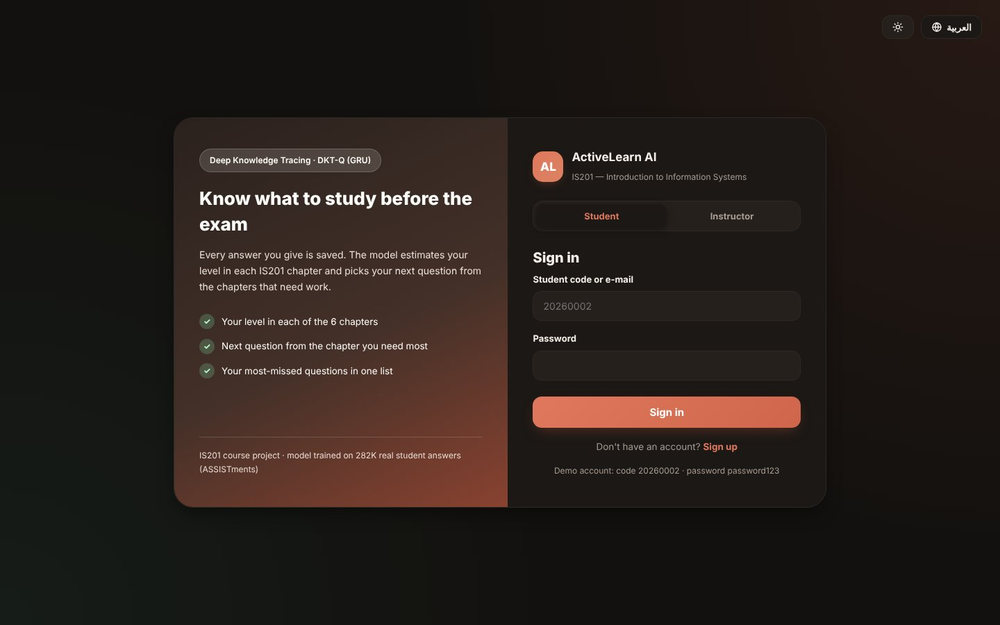
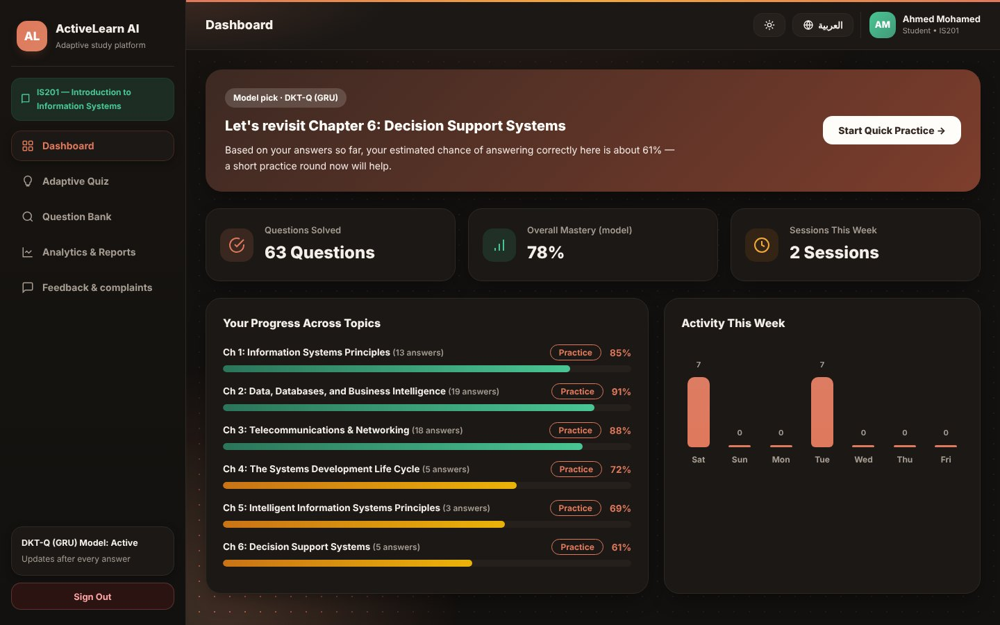
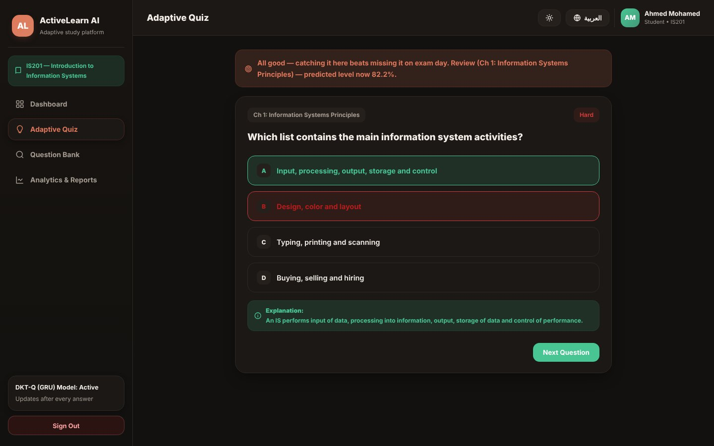
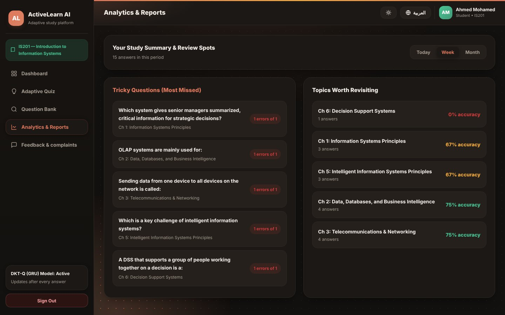
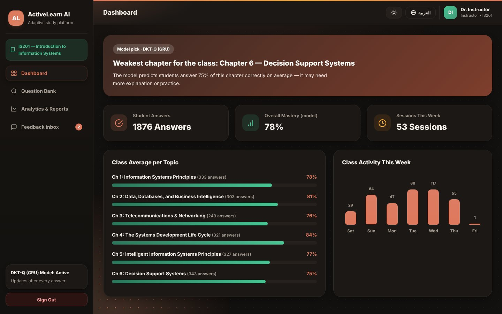
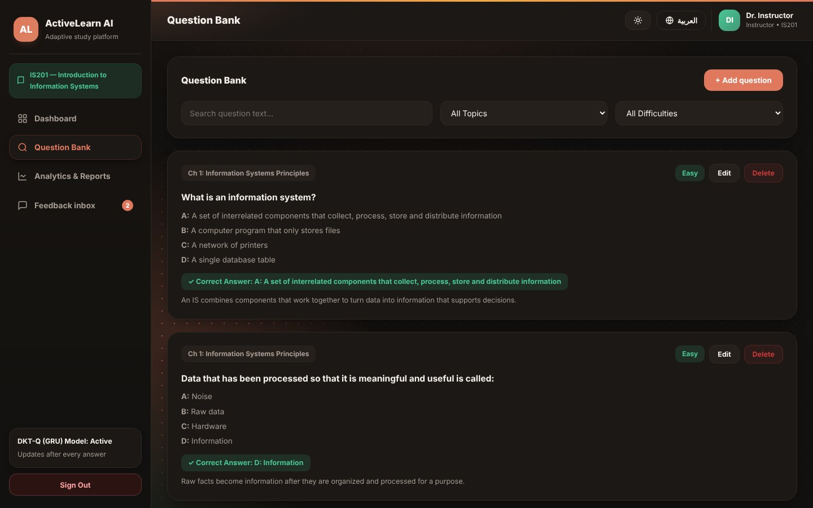
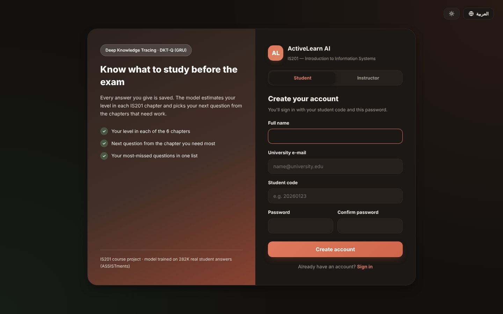
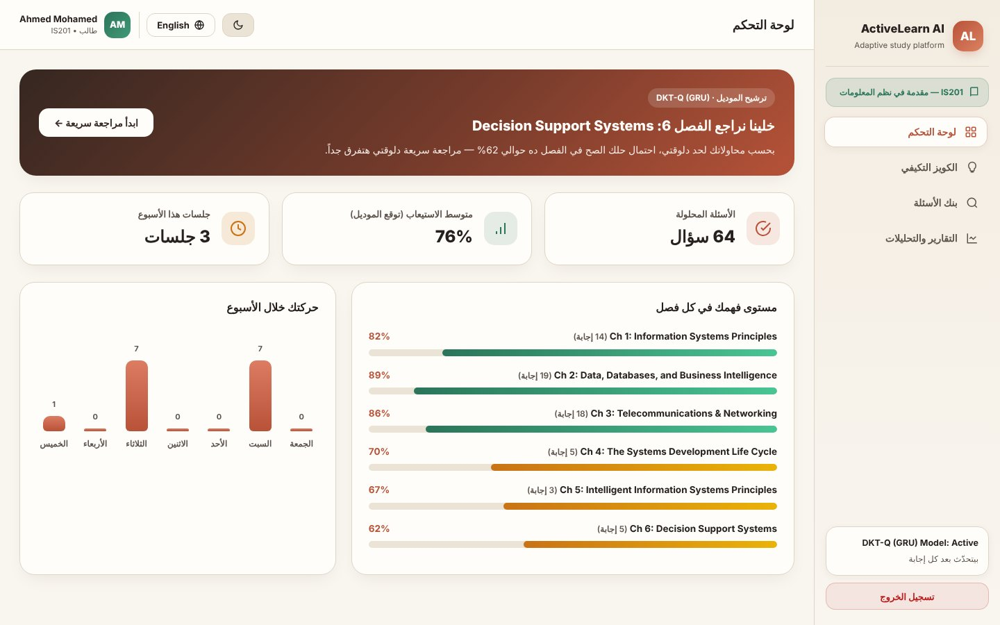
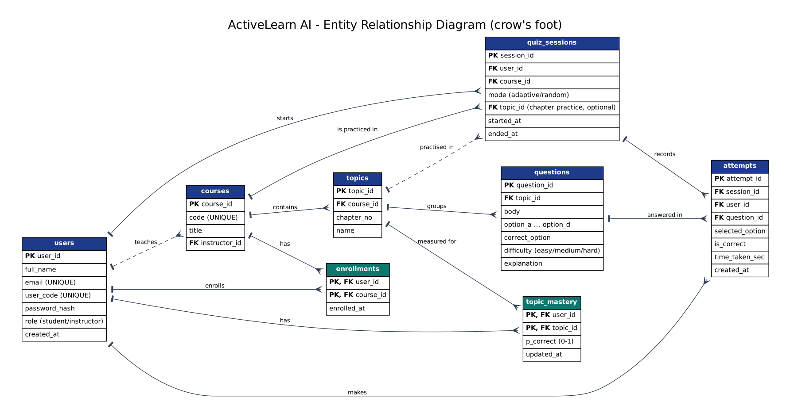

# ActiveLearn AI

**Team Inception · _Study smart. Dream big._**

An adaptive study platform with a knowledge-tracing neural network. Built for the IS201 (Introduction to Information Systems)
course project at the Faculty of Computers & AI, Benha University, and entered in the BS4 Spark2Build competition (Active Learning track).

> **Problem:** students answer practice questions at random and only find out which chapters they are weak in on exam day.
>
> **Solution:** every answer is stored in a database. A neural network (DKT / DKT-Q / SAKT) predicts how likely the student is
> to answer each question and chapter correctly. The next question is chosen mostly from the weak chapters, at a difficulty
> that fits the student's level. Students and instructors get reports.

**🌐 Live demo:** https://omarscitech.pythonanywhere.com &nbsp;·&nbsp; **▶️ Demo video (2 min):** https://youtu.be/dbNEImDmta8

[](https://youtu.be/dbNEImDmta8)

 
 

## Results at a glance
Trained and tested on **real student data** (ASSISTments 2009-2010: 282,619 answers, 3,852 students, 149 skills),
test set = students the model never saw:

| Model | Test AUC | Test accuracy |
|---|---|---|
| **DKT-Q (GRU + question embedding)** | **0.776** | **0.741** |
| DKT (GRU) | 0.759 | 0.734 |
| SAKT (self-attention) | 0.757 | 0.729 |
| Best simple baseline (recency formula) | 0.701 | – |

Training curves and all metrics: [`model/results/`](model/results). Details: [`model/README.md`](model/README.md).

## Screenshots
| Sign in | Student dashboard |
|---|---|
|  |  |
| **Adaptive quiz with instant feedback** | **Personal reports** |
|  |  |
| **Instructor: class dashboard** | **Instructor: question bank** |
|  |  |
| **Sign up** | **Arabic interface, light theme** |
|  |  |

## Features
- **Students:** dashboard with AI mastery per chapter, adaptive quiz with explanations, chapter practice
  (questions from one chapter, with difficulty that follows the student's level in it), question bank with search & filters, personal reports.
- **Instructor:** class dashboard, add / edit / delete questions, class reports for today / this week / this month,
  hardest questions, questions whose difficulty label looks wrong.
- **Arabic / English** interface.
- **Security:** hashed passwords (scrypt + salt), signed login tokens, role checks (student vs instructor), parameterized SQL.

## Quick start (Windows)
1. Install [Python 3.10+](https://www.python.org/downloads/) (tick "Add Python to PATH").
2. Download this repository (green **Code** button → **Download ZIP**) and unzip it.
3. **Double-click `run.bat`**. It installs Flask if needed and opens http://localhost:5000.
   Keep the black window open while you use the app.

Other systems: `pip install flask itsdangerous werkzeug` then `python backend/app.py`.
Without `torch` the app runs the numpy copy of the same model (`numpy` is needed).

The first screen is **Sign in**; new users press **Don't have an account? Sign up**.

| Account | How |
|---|---|
| Student (demo) | Sign in with student code `20260002` and password `password123` |
| New student | Sign up → name, university e-mail, student code, password → then sign in with the code |
| Instructor | Sign up → Instructor → name, staff code, course (IS201), password. On your own computer no key is needed; on the live site instructors need the activation key from the team |

## Folder structure
```
ActiveLearn_AI/
├── run.bat          double-click to start
├── frontend/        index.html – the interface (served by the backend)
├── backend/         Flask API: app.py, mastery.py (AI hook), seed.py (demo DB), test_api.py
├── database/        create_database.py (8 tables + 6 chapters + 60 questions, in Python), ERD, student simulator
├── analysis/        reports.sql (13 reports), make_charts.py → charts/, export_for_ai.py
├── model/           PyTorch: dkt.py (DKT, DKT-Q, SAKT), prepare_data.py, train.py, predictor.py, results/, saved/
│                    predictor_np.py + export_numpy.py: the same model without PyTorch (for hosting)
├── deploy/          PythonAnywhere WSGI file and hosting guide
├── docs/            screenshots and the demo-video thumbnail
└── requirements.txt
```
Every folder has its own README.

## How the parts connect
```
student answers a question (frontend)
  → POST /api/quiz/<id>/answer (backend) → saved in the attempts table (database)
  → mastery.py runs the active model on the student's whole history → topic_mastery
  → next question: a chapter drawn with weight (1 − mastery)², a difficulty drawn by the student's level
  → reports.sql, the report endpoints and the charts read the same tables (analysis)
```

## Database


The database is written in Python (`sqlite3`). Build it with `python database/create_database.py`, then open
`database/activelearn.db` in **DB Browser for SQLite** (details in [`database/README.md`](database/README.md)).

## Course requirements
| Requirement | Where |
|---|---|
| At least 3 tables in a real database | 8 tables – `database/create_database.py` |
| Database coded by the team | `database/create_database.py` (Python + sqlite3), opens in DB Browser for SQLite |
| Reports (best / worst, day / week / month) | `analysis/reports.sql` (13 reports), report endpoints, `analysis/charts/` |
| Search and filter | `GET /api/questions?search=&chapter=&difficulty=`, report R13 |
| GUI (Flask) | `frontend/index.html` + Flask API |
| ERD | `database/erd.png` |
| Documentation | this README + one README per folder |

## Data: what is real and what is simulated
- **ASSISTments 2009-2010** (real students): used to train and test the models. The ~60 MB CSV is not included;
  download it from the [ASSISTments site](https://sites.google.com/site/assistmentsdata/home/2009-2010-assistment-data/skill-builder-data-2009-2010).
- **IS201 chapters and 60 questions**: written by the team in `database/create_database.py`.
- **Answers in the demo database**: **simulated** students named "Sim Student …" (`database/simulate_students.py`),
  because the app has no real users yet. The app's IS201 model is trained on these and should be retrained
  once real students use it (`model/README.md`).

## Rebuild / retrain
```
cd backend  && python seed.py          # rebuild the demo database
cd ..\model && python predict_all.py   # AI predictions for every student
cd ..\analysis && python make_charts.py
cd ..\backend && python test_api.py    # tests every endpoint (prints ALL OK)
```

## Hosting
Step-by-step guide for a free permanent link on PythonAnywhere: [`deploy/README.md`](deploy/README.md).
The hosted site runs the numpy copy of the trained model (`model/predictor_np.py`, same predictions as PyTorch),
creates its own random `SECRET_KEY`, and keeps its database outside the git folder.

## Team Inception
| Member | Role |
|---|---|
| Omar Mohamed Gamal El-Din | Lead Software Developer / Deep Learning Engineer (`model/`) |
| Omar Mohamed El-Sayed El-Dereidy | Data Analyst (`analysis/`) |
| Omar Kamal Mostafa Youssef | Database Developer (`database/`) |
| Omar Essam Abdelkader Mohamed Tabaa | Back-End Developer (`backend/`) |
| Omar Reda Abdou El-Sawy | Front-End / UI Engineer (`frontend/`) |
